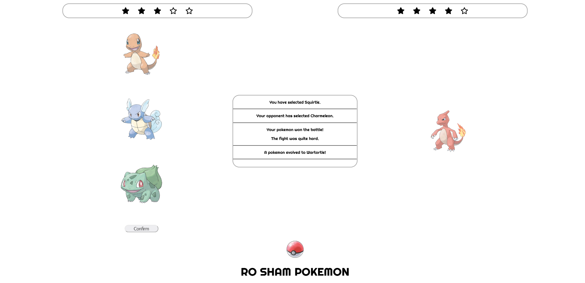

# Ro Sham Pokemon

A game similar to Rock Paper Scissors: the player and the computer each choose a Pokemon among three, and the winner is determined based on the type and the level of the Pokemon.

## About The Project

From the original README: this project is the author's take on the "Project: Rock Paper Scissors" of [The Odin Project](https://www.theodinproject.com/) Foundations course. The original assignment text is preserved in [ASSIGNMENT.md](ASSIGNMENT.md).

From the author's notes: the game is played against the computer; both sides pick one of the three first-generation starter Pokemon, the game ends after one side wins 5 rounds, and a Pokemon can evolve into a stronger one after winning a few rounds. The project was renamed to Ro Sham Pokemon and its images switched to local files after the first release.

### Demonstration

The project is deployed with GitHub Pages: [dyrits.github.io/RO-SHAM-POKEMON](https://dyrits.github.io/RO-SHAM-POKEMON/)

### Status

Completed, per the original README.

## Built With

- HTML / CSS
- JavaScript

## Getting Started

Open `index.html` in a browser.

## License

No license file is present in this repository.

## Contact

Dylan J. Gerrits - [GitHub](https://github.com/Dyrits)
